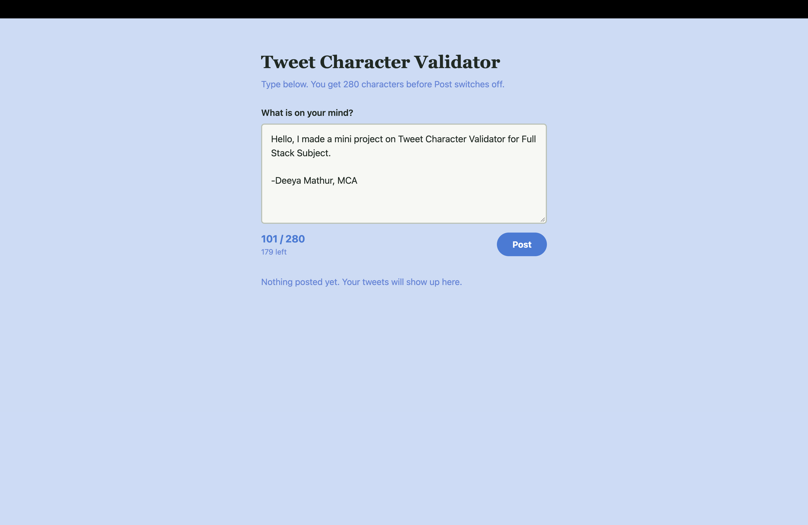
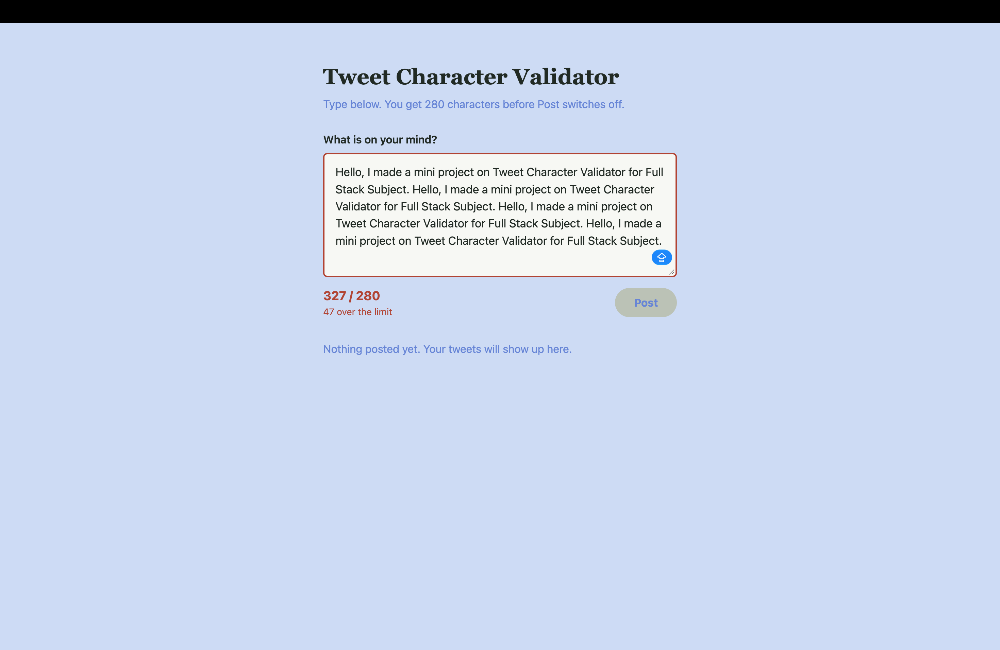
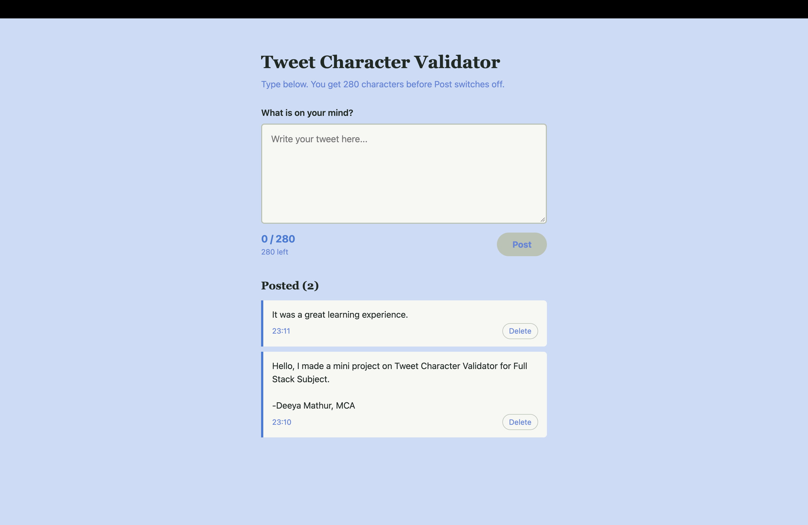

# Tweet Character Validator

A small React application that validates tweet length while you type. It features a live character counter, input validation, and a simple interface for managing posted tweets.

If the text exceeds **280 characters**, the textarea border turns red and the Post button is disabled. Posted tweets appear in a list below, with the newest tweet displayed first. Each tweet can be deleted, and all posts are saved in the browser using `localStorage`, so they remain available after refreshing the page.

Built as a beginner-friendly project using one page, four components, and React state.

## Preview

### Post Preview

### Character Limit Exceeded

### Post List


## Features

- Counts characters live while typing.
- Displays the number of characters remaining or exceeded.
- Counter turns amber when 20 or fewer characters remain.
- Textarea border turns red when the character limit is exceeded.
- Post button is disabled when the text exceeds 280 characters.
- Post button is also disabled when the input is empty or contains only spaces.
- Clicking Post adds the tweet to the list and clears the textarea.
- Newly posted tweets appear first.
- Each posted tweet has a Delete button.
- Tweets are saved in browser `localStorage` and persist after refreshing the page.

## Tech Stack

| Technology | Purpose |
|---|---|
| React | Building the user interface using reusable components |
| Vite | Development server and build tool |
| CSS | Styling and responsive layout |
| localStorage | Saving posted tweets in the browser |

## Concepts Practiced

- React functional components
- State management using `useState`
- Props and component communication
- Conditional rendering and styling
- Event handling
- Input validation
- Browser storage using `localStorage`

## How to Run

**Prerequisites:** [Node.js](https://nodejs.org/) (version 18 or newer).

1. Clone the repository:

   ```bash
   git clone <repository-url>
   ```

2. Navigate to the project folder:

   ```bash
   cd tweet-validator
   ```

3. Install the dependencies:

   ```bash
   npm install
   ```

4. Start the development server:

   ```bash
   npm run dev
   ```

5. Open the local address shown in the terminal (usually `http://localhost:5173`).

### Production Build

To create a production-ready build:

```bash
npm run build
```

## Project Structure

```text
tweet-validator/
├── index.html
├── package.json
├── vite.config.js
└── src/
    ├── main.jsx
    ├── App.jsx
    ├── index.css
    └── components/
        ├── TweetBox.jsx
        ├── CharCounter.jsx
        ├── PostButton.jsx
        └── TweetList.jsx
```

### Component Overview

| Component | Responsibility |
|---|---|
| `App.jsx` | Manages posted tweets, adding, deleting, and saving them |
| `TweetBox.jsx` | Handles the textarea and typed text |
| `CharCounter.jsx` | Displays the character count and remaining limit |
| `PostButton.jsx` | Handles the Post button and its disabled state |
| `TweetList.jsx` | Displays posted tweets and their Delete buttons |

## Author

**Deeya Mathur**  
Master of Computer Applications (MCA)